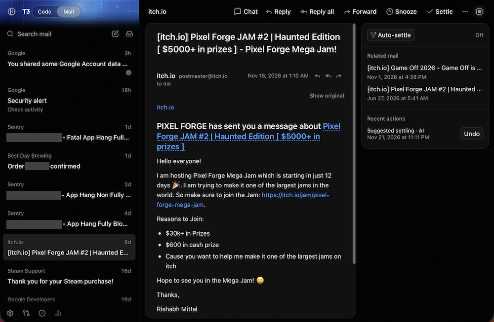

# Code + Mailbox

Code + Mailbox is an unofficial fork based on the [T3 Code](https://github.com/pingdotgg/t3code) source code. It is not affiliated with, endorsed by, or maintained by T3 Tools, Inc.

Code + Mailbox adds an email inbox to the web and desktop clients. Read and reply to mail, ask your configured coding agent about a conversation, or let a rule settle recurring receipts and notifications. You can move any settled thread back to the inbox.



## Run Mail from source

Install Git and [Vite+](https://viteplus.dev/guide/), then run:

```sh
git clone -c core.longpaths=true --branch mail https://github.com/naturalnick/t3code-mail.git
cd t3code-mail
vp i
vp run dev --home-dir .t3 --no-seed
```

Open the pairing URL printed in the terminal. This starts the fork with its own data directory inside the clone. Choose **Mail**, then **Settings → Mail → Accounts → Add account**. Gmail requires an app password. Other accounts need IMAP and SMTP access. For an optional mail model, choose a provider you already use in T3 Code.

## What happens to your mail

- Synced messages and drafts live on the computer running T3 Code. AI triage and mail chat send message content to the model provider you select.
- **Settle** clears a thread from the active list. Archiving it in your provider’s inbox is a separate setting. In an email’s details, **Auto-settle** shows which rules apply to future mail and lets you edit or remove them.
- An agent can leave a draft. You review it and choose **Send** in Mail.

[Mail setup and features](./docs/user/mail.md) · [T3 Code documentation](./docs/README.md) · [Development](./docs/operations/00_development.md) · [MIT license](./LICENSE)
